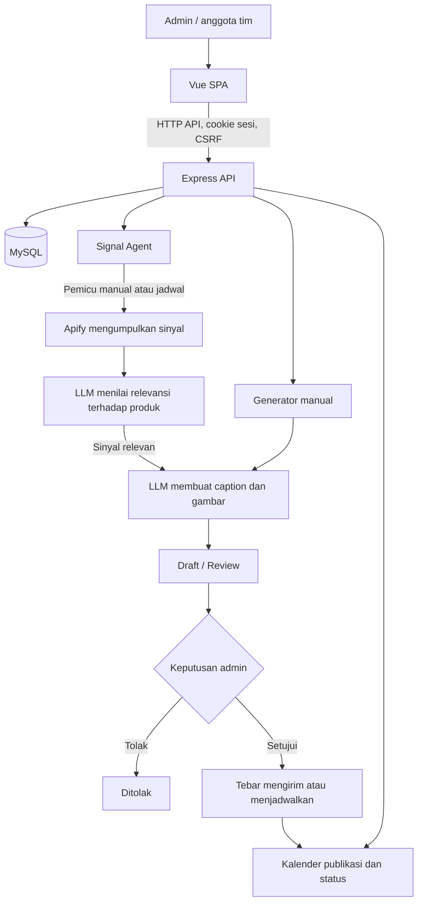

# Pulse AI

Pulse AI mengubah sinyal media sosial menjadi konten siap ditinjau dan dijadwalkan. Tim mengelola profil produk, memantau temuan Signal Agent, membuat caption dan gambar, lalu menyetujui publikasi lewat Tebar.

## Alur sistem



## Teknologi dan struktur

| Lokasi | Teknologi | Tanggung jawab |
| --- | --- | --- |
| [frontend/](frontend/) | Vue 3, Vite 8, TypeScript | Dashboard, akun, produk, Signal Agent, generator konten, kalender |
| [backend/](backend/) | Node.js 26+, Express 5, TypeScript, Zod | API, otorisasi, scheduler, integrasi provider |
| [backend/migrations/](backend/migrations/) | MySQL 9.7 | Skema dan migrasi data |
| [compose.yml](compose.yml) | Docker Compose | MySQL lokal |

Frontend dan backend memiliki dependency, konfigurasi, dan build sendiri. API dan scheduler Signal Agent berjalan dalam satu proses backend.

## Setup lokal

Perlu Node.js 26+, npm, Docker Compose, dan OpenSSL. Jalankan dari root repo.

```bash
cp .env.example .env
cp backend/.env.example backend/.env
cp frontend/.env.example frontend/.env
openssl rand -base64 32
```

Samakan `DATABASE_PASSWORD` di kedua file env. Isi `MYSQL_ROOT_PASSWORD` di root, serta `SETTINGS_ENCRYPTION_KEY`, `ADMIN_EMAIL`, dan `ADMIN_PASSWORD` di backend. Gunakan hasil OpenSSL sebagai kunci enkripsi.

```bash
docker compose up -d --wait mysql
npm --prefix backend ci
npm --prefix backend run migrate
npm --prefix backend run seed
npm --prefix backend run dev
```

Di terminal kedua dari root repo:

```bash
npm --prefix frontend ci
npm --prefix frontend run dev
```

Buka [web lokal](http://localhost:5173). API tersedia di [localhost:3000](http://localhost:3000/api/health).

## Integrasi

- **Apify** mengumpulkan sinyal untuk Signal Agent.
- **LLM OpenAI-compatible** menilai relevansi dan menghasilkan teks serta gambar. Provider perlu mendukung `POST /chat/completions` dan `POST /images/edits` dengan respons gambar base64. Tes koneksi model memakai `GET /models`.
- **Tebar** menyediakan akun sosial, publikasi, penjadwalan, dan status post.

Konfigurasikan melalui Settings. Kredensial provider tersimpan terenkripsi di MySQL. Mutasi API memerlukan CSRF dan akses ditentukan oleh role atau izin modul.

## Verifikasi

```bash
npm --prefix backend run build
npm --prefix backend run test:coverage
npm --prefix frontend run build
npm --prefix frontend run test:coverage
(cd frontend && npx playwright install chromium && npm run e2e)
```

## Rilis produksi

1. Sajikan `frontend/dist` melalui HTTPS dengan fallback SPA ke `index.html`. Teruskan `/api/*` ke Express pada origin yang sama. Build FE dengan `VITE_API_URL=`. Set `FRONTEND_URL` ke origin publik dan `NODE_ENV=production` di BE.
2. Set `PROVIDER_ORIGINS` ke daftar origin HTTPS provider yang disetujui. Simpan `SETTINGS_ENCRYPTION_KEY` bersama secret rilis agar kredensial pada backup tetap dapat dibaca.
3. Jalankan satu proses API per skema MySQL. Hentikan API, ambil snapshot, lalu jalankan `node dist/db/migrate.js` dari backend, dengan direktori `migrations/` tersedia. Jalankan `node dist/db/seed.js` pada instalasi baru.
4. Mulai API dengan `npm start` dari backend. Pastikan `GET /api/health` mengembalikan 200. Jika migrasi gagal sebagian, pulihkan snapshot sebelum mengulang. Untuk rollback lintas skema, pulihkan snapshot lalu gunakan artefak FE/BE versi sebelumnya.

**Status audit:** smoke HTTPS lokal dan restore MySQL lolos. Rilis masih menunggu coverage backend 80% dan verifikasi idempotensi publikasi dengan Tebar live.
